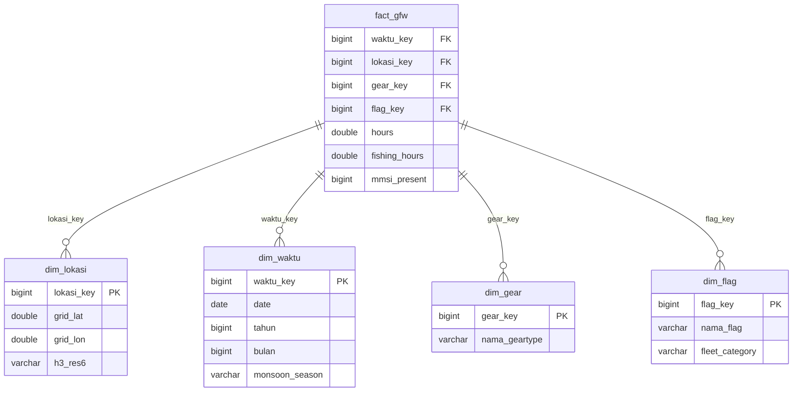
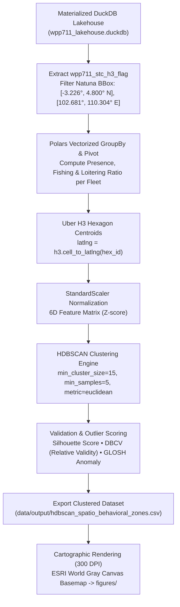
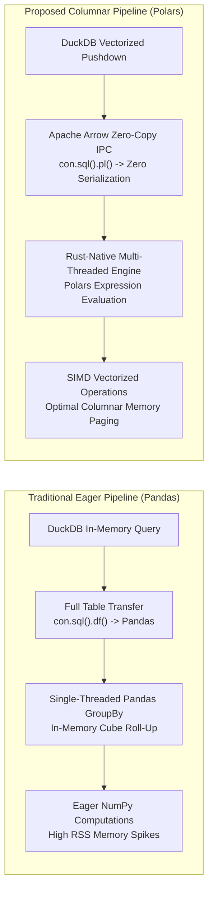

<div align="center">

# 🌊 Spatio-Temporal HDBSCAN Fleet Clustering & Polars Benchmarking

### *Unsupervised Marine Spatial Planning (MSP) & High-Throughput OLAP Analytics in WPPNRI 711 (Natuna Sea)*

[](https://www.python.org/)
[](https://pola.rs/)
[](https://duckdb.org/)
[](https://h3geo.org/)
[](https://hdbscan.readthedocs.io/)
[](https://jurnal.iaii.or.id/index.php/RESTI)

<p align="center">
  <a href="#-research-overview">Research Overview</a> •
  <a href="#-repository-structure">Repository Structure</a> •
  <a href="#-data-architecture--lakehouse-schema">Data Architecture</a> •
  <a href="#-hdbscan-spatio-temporal-clustering-pipeline">HDBSCAN Pipeline</a> •
  <a href="#-columnar-benchmarking-architecture">Benchmark Architecture</a> •
  <a href="#-hardware--environment-specifications">Host Specifications</a> •
  <a href="#-reproduction-guide">Reproduction Guide</a> •
  <a href="#-references">References</a>
</p>

---

</div>

## 📌 Research Overview

This repository provides the official source code, analytical pipelines, and data warehouse artifacts supporting the research paper submitted to **Jurnal RESTI (Rekayasa Sistem dan Teknologi Informasi)**.

The research investigates computational and geospatial methods in **Indonesia's Fisheries Management Area 711 (WPPNRI 711 — Natuna Sea, Karimata Strait, and West Kalimantan)** across two core dimensions:

1. **Unsupervised Spatio-Temporal Behavioral Segregation (HDBSCAN):**  
   A density-based spatial clustering methodology operating over **Uber H3 discrete global grid systems (DGGS)** to uncover spatial segregation between **Domestic Archipelagic Fleets (IDN)** and **Transboundary Fleets (Non-IDN)** across four distinct Asian monsoon regimes.
2. **High-Throughput Columnar OLAP Analytics (Polars vs. Pandas):**  
   A zero-copy lakehouse pushdown architecture pairing **DuckDB**, **Apache Arrow IPC**, and **Polars multi-threaded Rust execution** to eliminate in-memory serialization bottlenecks inherent in traditional Pandas pipelines.

> [!NOTE]
> In accordance with academic publishing standards, **all empirical cluster statistics, validation scores, cartographic figures, and benchmark findings are presented in the research article**. This repository focuses strictly on the **data architecture, analytical pipeline implementation, and reproduction environment**.

---

## 🏛️ Repository Structure

The repository is structured to maintain clean separation between lakehouse storage, execution logic, configuration parameters, and generated outputs:

```text
C:\resti_journal\
├── data/
│   ├── raw/
│   │   └── wpp711_lakehouse.duckdb  # Materialized Lakehouse Data Warehouse (Tracked in repo)
│   └── output/                      # Destination for generated cluster datasets (Gitignored)
├── figures/                         # Destination for 300 DPI publication cartography (Gitignored)
├── src/
│   ├── __init__.py
│   ├── config.py                    # Spatial bounds, feature definitions & hyperparameters
│   ├── clustering.py                # HDBSCAN clustering engine & DBCV validation
│   ├── mapping.py                   # Contextily & GeoPandas cartographic visualizer
│   └── benchmark.py                 # 30-trial Wilcoxon benchmark engine
├── .gitignore                       # Excludes generated CSVs and figure outputs
├── requirements.txt                 # Pinned dependencies
└── README.md                        # Architectural documentation and reproduction guide
```

---

## 🗄️ Data Architecture & Lakehouse Schema

The analytical backend is built on **DuckDB** (`wpp711_lakehouse.duckdb`), combining star-schema dimensional modeling with a pre-materialized spatio-temporal cube to ensure zero-copy analytical execution:



### Table Specifications

| Table Name | Role / Grain | Key Columns & Schema Details |
| :--- | :--- | :--- |
| **`fact_gfw`** | Fact Table (Vessel Effort Observation) | Foreign Keys (`lokasi_key`, `waktu_key`, `gear_key`, `flag_key`), `hours`, `fishing_hours`, `mmsi_present`. Filtered to physical Natuna Sea bounding box $[-3.226^\circ, 4.800^\circ\text{ N}]$ and $[102.681^\circ, 110.304^\circ\text{ E}]$. |
| **`dim_lokasi`** | Spatial Dimension | Primary Key `lokasi_key`, centroid latitude (`grid_lat`), centroid longitude (`grid_lon`), and Uber H3 Resolution 6 hexagon index (`h3_res6`). |
| **`dim_waktu`** | Temporal Dimension | Primary Key `waktu_key`, full calendar date (`date`), calendar `tahun`, `bulan`, and climatological `monsoon_season` classification. |
| **`dim_gear`** | Operational Gear Dimension | Primary Key `gear_key`, gear classification (`nama_geartype`: purse seiners, trawlers, longliners, etc.). |
| **`dim_flag`** | Geopolitical Flag Dimension | Primary Key `flag_key`, ISO country code (`nama_flag`), and fleet classification (`fleet_category`: `IDN_Fleet` vs `Non_IDN_Fleet`). |
| **`wpp711_stc_h3_flag`** | Materialized Spatio-Temporal Cube | Pre-aggregated spatio-temporal cube indexed by `(hex_id, monsoon_season, fleet_category)` with sum of `total_presence_hours` and `total_fishing_hours` for high-throughput analytical reads. |

---

## 🧠 HDBSCAN Spatio-Temporal Clustering Pipeline

### 1. Spatial Binning & Kinematic Feature Space
Vessel trajectory pings are binned into **Uber H3 Resolution 6 hexagonal cells** ($~36.1\text{ km}^2$ cell area, $~3.6\text{ km}$ edge length). For each hexagon $h$ and monsoon phase $s$, non-fishing behavior is quantified through the **Loitering Ratio** ($R_{\text{loiter}}$):

$$R_{\text{loiter}} = \frac{T_{\text{presence}} - T_{\text{fishing}}}{T_{\text{presence}}} \quad \text{where } T_{\text{presence}} > 0$$

Each spatial cell is represented by a standardized **6-Dimensional Feature Vector**:

$$\mathbf{x}_h = \Big[\text{lat}_h, \, \text{lon}_h, \, T_{\text{fish}}^{\text{IDN}}, \, T_{\text{fish}}^{\text{Non-IDN}}, \, R_{\text{loiter}}^{\text{IDN}}, \, R_{\text{loiter}}^{\text{Non-IDN}}\Big] \in \mathbb{R}^6$$

*(Total presence hours are excluded from the clustering matrix to prevent collinearity with fishing hours).*



### 2. Algorithmic Formulation & Validation Objective
* **Algorithm:** Hierarchical Density-Based Spatial Clustering of Applications with Noise (**HDBSCAN**)
* **`min_cluster_size = 15`:** Minimum cluster mass to filter transient vessel traffic and preserve sustained operational hotbeds.
* **`min_samples = 5`:** Core neighborhood density smoothing parameter.
* **Distance Metric:** Euclidean distance over $Z$-score standardized 6D space.
* **Validation Metrics:**
  * **Silhouette Coefficient:** Cohesion vs. separation across detected fleet concentrations.
  * **Density-Based Cluster Validation (DBCV / Relative Validity):** Evaluates density separation across non-globular manifold geometries without penalizing noise points.
  * **GLOSH Anomaly Score:** Global-Local Outlier Score from Hierarchies evaluating transitional/outlier cells.

### 3. Geopolitical Maritime Zone Classification
Micro-clusters identified by HDBSCAN are systematically categorized into three operational zones based on operational dominance:
1. **Domestic Archipelagic Zones (IDN Dominant):** Hexagons where domestic Indonesian fishing hours exceed transboundary activity.
2. **Transboundary Corridors (Non-IDN Dominant):** Peripheral border hotbeds dominated by foreign industrial fishing vessels.
3. **Kinematic Outliers (Cluster -1 Noise):** Isolated AIS pings, transit lanes, or sporadic vessel movements.

---

## ⚡ Columnar Benchmarking Architecture

To evaluate data processing efficiency, the repository includes a standardized benchmarking harness comparing:
* **Baseline Pipeline (Pandas):** Traditional eager SQL extraction (`con.sql().df()`), single-threaded Pandas `.groupby()`, and sequential NumPy `np.select()` / `np.where()`.
* **Proposed Pipeline (Polars):** Vectorized DuckDB aggregation pushdown, **Apache Arrow zero-copy memory transfer** (`con.sql().pl()`), and multi-threaded Rust execution.



### Experimental Rigor & Statistical Controls
* **Hardware Preemption Elimination:** Host OS process priority set to `HIGH_PRIORITY_CLASS` (`psutil`) to eliminate kernel scheduling preemption.
* **Cold-Start Bias Elimination:** Dedicated warm-up iteration executed before measurements begin.
* **Memory Paging Isolation:** Resident Set Size ($\Delta\text{RSS}$) measured per trial with explicit garbage collection (`gc.collect()`).
* **Trial Sample Size:** $N = 30$ independent paired trials.
* **Hypothesis Testing:** Non-parametric two-tailed **Wilcoxon Signed-Rank Test** evaluating paired latency distributions.

---

## 💻 Hardware & Environment Specifications

All computational pipelines and empirical benchmarks were executed on the following standardized physical host machine:

| Component / Layer | Specification Details |
| :--- | :--- |
| **Processor (CPU)** | **AMD Ryzen 7 5800HS with Radeon Graphics** |
| **Architecture** | x86_64 / Zen 3 (8 Physical Cores, 16 Logical Processors / Threads) |
| **Clock Frequency** | Base Clock: **$3.20\text{ GHz}$**, Max Boost Clock: up to **$4.40\text{ GHz}$** |
| **CPU Cache** | L1: $512\text{ KB}$, L2: $4.0\text{ MB}$, L3: $16.0\text{ MB}$ |
| **Physical Memory (RAM)** | **$16.0\text{ GB}$ DDR4** ($15.40\text{ GB}$ usable physical memory) |
| **Storage Subsystem** | High-speed NVMe PCIe M.2 Solid State Drive (SSD) |
| **Operating System** | **Microsoft Windows 11 Home Single Language** (64-bit, Build 26200) |
| **Python Environment** | **Python 3.14.0** (CPython 64-bit) |
| **OLAP Engine** | **DuckDB v1.5.4** |
| **Dataframe Engine** | **Polars v1.44.1** (Vectorized Rust engine with AVX2 SIMD acceleration) |
| **Baseline Dataframe** | **Pandas v2.2.3** / NumPy v2.2.3 |
| **Geospatial & Spatial** | **Uber H3 v4.4.2**, **GeoPandas v1.1.2**, **Shapely v2.1.2** |
| **Clustering & ML** | **Scikit-learn v1.8.0**, **hdbscan v0.8.40** |

---

## 🚀 Reproduction Guide

Follow these steps to reproduce the data processing, spatial clustering, mapping, and benchmarking pipelines locally:

### 1. Environment Setup

```bash
# Navigate to project root
cd C:\resti_journal

# Create and activate virtual environment
python -m venv venv
venv\Scripts\activate

# Install dependencies
pip install -r requirements.txt
```

### 2. Run HDBSCAN Clustering Pipeline

Executes the seasonal spatio-temporal cube extraction, computes loitering ratios, runs HDBSCAN clustering, and exports cluster labels with anomaly scores:

```bash
python src/clustering.py
```
*Destination: `data/output/hdbscan_spatio_behavioral_zones.csv`*

### 3. Generate Publication Cartography (300 DPI)

Constructs spatial polygon geometries from Uber H3 indexes and renders ESRI World Gray Canvas basemapped maps for all four monsoon seasons:

```bash
python src/mapping.py
```
*Destination: High-resolution PNGs saved to `figures/`*

### 4. Run Polars vs. Pandas Benchmark

Executes the 30-trial comparative evaluation across wall-clock latency, CPU processing time, and peak memory usage, performing Wilcoxon signed-rank inference:

```bash
python src/benchmark.py
```

---

## 📚 References

Key literature cited in the research article:

* **Campello, R. J., Moulavi, D., & Sander, J.** (2013). *Density-based clustering based on hierarchical density estimates*. Pacific-Asia Conference on Knowledge Discovery and Data Mining (PAKDD), Springer, 160–172.
* **Kroodsma, D. A., et al.** (2018). *Tracking the global footprint of fisheries*. Science, 359(6378), 904–908.
* **Paolo, F. S., et al.** (2024). *Satellite mapping reveals extensive industrial activity at sea*. Nature, 625(7993), 85–91.
* **Ritchie, R.** (2024). *Polars: Lightning-fast DataFrame library*. [https://pola.rs/](https://pola.rs/)
* **Raasveldt, M., & Mühleisen, H.** (2019). *DuckDB: an Embeddable Analytical Database*. ACM SIGMOD International Conference on Management of Data, 1981–1984.
* **Uber Technologies.** (2018). *H3: Hexagonal Hierarchical Spatial Indexing System*. [https://h3geo.org/](https://h3geo.org/)

---

<div align="center">
  <sub>Research Article Codebase Prepared for Jurnal RESTI (Rekayasa Sistem dan Teknologi Informasi).</sub>
</div>
